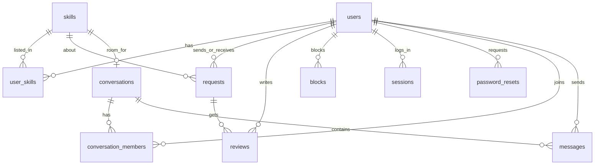

# Skill Swap

A community website where people teach what they know and learn what they need by swapping skills.
It finds people whose skills fit together, lets them chat, swap and rate each other, and has group rooms for every skill.

## How to run (Windows, Mac, Linux)

1. Install Node.js (version 18 or newer) from https://nodejs.org
2. Open a terminal **inside this folder** and run:

```
npm install
npm start
```

3. Open http://localhost:3000

There is no build step and nothing to compile.

## Deploy on Vercel + Turso (free)

Vercel has no permanent disk, so the deployed app stores its data in a free
[Turso](https://turso.tech) database instead of `data/skillswap.db`. Locally
nothing changes.

1. Sign up at https://turso.tech and create a database.
   Choose the **libSQL** engine (not "Turso Database"), and pick a region near you.
2. Open the database and copy its **URL** (`libsql://...`).
3. Create an **auth token** for that database and copy it.
4. In a terminal inside this folder, run:

```
npx vercel login
npx vercel link
npx vercel env add TURSO_DATABASE_URL
npx vercel env add TURSO_AUTH_TOKEN
npx vercel --prod
```

For each `env add`, paste the value and select at least **Production**.
Vercel prints the live URL when it finishes.

If you deploy without those two variables, the API returns a clear error
telling you what is missing (the pages still load).

## Features

| Area | What it does |
|---|---|
| Landing page | Public home page with sign up and log in buttons |
| Accounts | Sign up, log in, log out. Passwords are stored as bcrypt hashes. Login sessions use a secure cookie |
| Password safety | Change password, forgot / reset password (one-time link, valid 30 minutes), 5 wrong tries locks login for 5 minutes |
| Skills | List skills you teach and skills you want to learn, with a level |
| Browse | Search people by skill and level |
| Matches | Perfect matches (they teach what you want AND want what you teach) and partial matches |
| Requests | Send, accept, decline, cancel, mark completed, then rate each other (1 to 5 stars) |
| Private chat | Opens automatically when a request is accepted. Messages are 1 to 500 characters |
| Group rooms | One chat room per skill. Anyone can join or leave |
| Safety | Block people. Blocked people cannot find you, send requests, or message you. Emails are never shown to others |
| Account | Edit name, change password, see blocked people, delete account |

## Demo logins

Password for every sample account: **demo1234**

| Name | Email |
|---|---|
| Priya | priya@skillswap.local |
| Arun | arun@skillswap.local |
| Meera | meera@skillswap.local |
| Divya | divya@skillswap.local |
| Karthik | karthik@skillswap.local |
| Ravi | ravi@skillswap.local |

On the login page you can click a sample account to log in.
Priya and Arun are a perfect pair (Guitar and Excel). Meera and Divya are another (Cooking and Yoga) and already have a chat. Ravi has sent Priya a pending request. The Guitar and Excel rooms already have messages.

To reset all data, stop the server, delete `data/skillswap.db`, and start again.

## How the parts connect

```
Browser (HTML/CSS/JS)  ->  Express server (Node.js)  ->  libSQL database
      public/                server.js + routes/          local: data/skillswap.db
                                                          Vercel: Turso
```

- `public/` - the pages. JavaScript calls the server with `fetch('/api/...')`.
- `routes/` - the API (`auth`, `users`, `skills`, `requests`, `messages`, `rooms`).
- `auth.js` - login sessions, cookies, password rules.
- `chat.js` - small helpers for blocking and direct chats.
- `db.js` - creates the tables, adds sample data, and connects to Turso when
  `TURSO_DATABASE_URL` is set (otherwise to the local file).

## Pages

| Page | Who can open it |
|---|---|
| `index.html` (landing), `login.html`, `signup.html`, `forgot.html`, `reset.html` | Everyone |
| `browse.html`, `matches.html`, `requests.html`, `messages.html`, `rooms.html`, `profile.html` | Logged-in users |

## ER diagram



Direct chats and group rooms use the same three tables (`conversations`, `conversation_members`, `messages`).
A direct chat has 2 members. A room has `type = 'room'`, a `skill_id` and many members.

## API list

| Method | Endpoint | Purpose |
|---|---|---|
| POST | /api/auth/signup | Create account |
| POST | /api/auth/login | Log in |
| POST | /api/auth/logout | Log out |
| GET | /api/auth/me | Who is logged in |
| POST | /api/auth/change-password | Change password |
| POST | /api/auth/forgot | Create a reset link |
| POST | /api/auth/reset | Set a new password with the link |
| DELETE | /api/auth/account | Delete my account |
| GET | /api/me/profile | My profile and skills |
| PUT | /api/me | Edit my name |
| GET | /api/me/counts | Badge numbers |
| POST / DELETE | /api/me/skills | Add / remove a skill |
| GET | /api/skills | All skills |
| GET | /api/browse?skill=&level= | Search people |
| GET | /api/matches | Perfect and partial matches |
| GET | /api/users/:id/public | Skills, rating, reviews |
| GET / POST / DELETE | /api/blocks | List / block / unblock |
| POST | /api/requests | Send request |
| GET | /api/requests | Incoming and sent |
| PUT | /api/requests/:id | Accept, decline or complete |
| POST | /api/requests/:id/review | Rate the other person |
| DELETE | /api/requests/:id | Cancel |
| GET | /api/conversations | My chats and rooms |
| GET / POST | /api/conversations/:id/messages | Read / send messages |
| GET | /api/rooms | All skill rooms |
| POST | /api/rooms/:skillId/join, /leave | Join or leave a room |

## Security notes

- Passwords are hashed with bcrypt. Reset tokens and login tokens are stored only as SHA-256 hashes.
- The login cookie is `HttpOnly` and `SameSite=Lax`, so page scripts cannot read it.
- Every route checks who you are on the server. You cannot act as someone else.
- All SQL uses parameters (`?`). All text shown on pages is escaped.
- Reset links are shown on screen in demo mode because there is no email server. Start with `DEMO_MODE=off` to hide them and the demo account list.

## Known simplifications

- Messages refresh by checking the server every 3 seconds (not real-time WebSockets).
- Password reset shows the link on screen instead of sending an email.
- SQLite (via `@libsql/client`). Local runs use a file; Vercel uses Turso. The SQL is standard and also works on MySQL.
